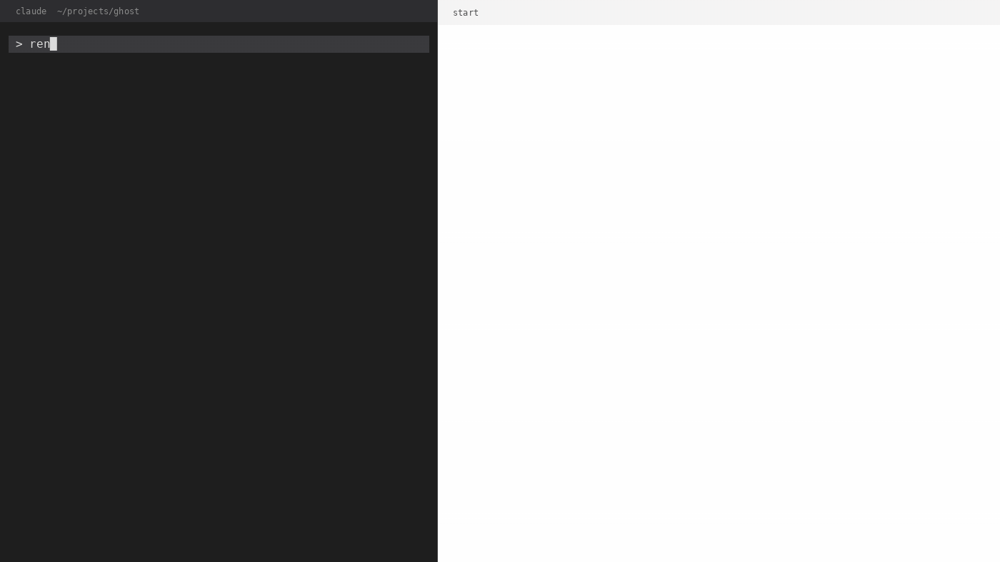

# clarc

Cloud architecture diagrams from a service graph. A cloud-specific diagramming tool built on c43-layout, plus a Claude Code skill that writes the graph for you.



Above: the skill renders a first version from the project's code and a short discussion, then the user steers the layout in plain words until the picture is right (`demo/demo.mp4` is the same recording as video).

## The tool

```bash
clarc --file graph.json > diagram.drawio
cat graph.json | clarc --file - > diagram.drawio
```

- `--aws` (default) and `--azure` choose the theme and guide the nature of services (data vs non-functional).
- Input comes from `--file`, where `-` means stdin, to support piping.
- Output is drawio XML on stdout, to support piping. Warnings (e.g. edge crossings, hints that could not be honoured) go to stderr.
- `--agentic-help` prints what an LLM needs to write the input: an example for the chosen theme (a few nodes, connections and a hints section), all hint directives, common glyph names, group frames and edge kinds.

### Input

A JSON document with `title`, `description`, optional `groups`, `nodes`, `edges` and `hints`.

- A node is an icon (`"service"` names a drawio glyph; without one it is a text box) with a label below it.
- An edge is a data flow by default and flows left to right. `"kind": "nf"` marks a non-functional link (DNS, monitoring, identity, configuration, image pull); those flow top to bottom and are dashed.
- Hints are suggestions honoured when possible, keyed by node: `start` (the left-most node, at most one), `leftOf`, `rightOf`, `above`, `below`, `sameRow`, `sameCol`.

Layout, edge routing, icon sizing and theming are done by clarc; nothing is placed by hand.

### Install

Every push to `main` publishes binaries as the rolling prerelease `latest` on GitHub Releases (linux x86_64/aarch64, macOS x86_64/aarch64, windows x86_64), with a `SHA256SUMS` file. Or build it:

```bash
cargo build --release   # target/release/clarc
```

## The Claude Code skill

The plugin lives in `claude-plugin/clarc`. The skill turns "draw the architecture of X" into a clarc input JSON, runs clarc, and shows the result:

1. It finds `clarc` (PATH, then `~/.local/share/clarc`, otherwise it downloads the `latest` release and verifies its checksum).
2. It learns the input format from `clarc --agentic-help`.
3. It collects the facts, either by **discovering them from code** (IaC, docs, specs) or by **generating them from a discussion** with you, for architectures that do not exist yet.
4. It renders a first version (`.drawio`, plus a PNG when the drawio CLI is on PATH). The drawio CLI is optional and never installed by the skill; without it you get the `.drawio` file to open in drawio and no preview image.
5. You drive the layout in prose ("put DNS above EventBridge", "move SQLite right of the generator"); the skill turns each wish into a hint and re-renders until you accept the image.

Use it in a session:

```
/plugin marketplace add well-architected-cloud-clarc/clarc
/plugin install clarc@clarc
```

A local checkout works too (`/plugin marketplace add /path/to/clarc`), and for one session only: `claude --plugin-dir /path/to/clarc/claude-plugin/clarc`. Then ask for a diagram or run `/clarc:clarc <what to draw>`.

## Reference architectures

The reference architectures are the phase1 and phase2 diagrams of https://github.com/dooreelko/ghosted. They need not be reproduced 1:1, but better is not wrong. The first scope is AWS for those two references plus a hypothetical Azure replica; the cases live in `tests/cases` and are the golden tests. Phase 3 (serverless) is the demo above.

## Development

- `cargo build --release` and `cargo test` must pass.
- `UPDATE_GOLDEN=1 cargo test` rewrites the expected drawio files in `tests/cases` after a deliberate rendering change; `scripts/render.sh` renders them to PNG/SVG with the drawio CLI.
- `demo/`: `render.py` recreates every step's drawio and PNG from `demo.json`; `make_gif.py` builds `demo.gif` and `demo.mp4` from them.
- Work is tracked with moth (`.moth/`), which holds the specifications.
